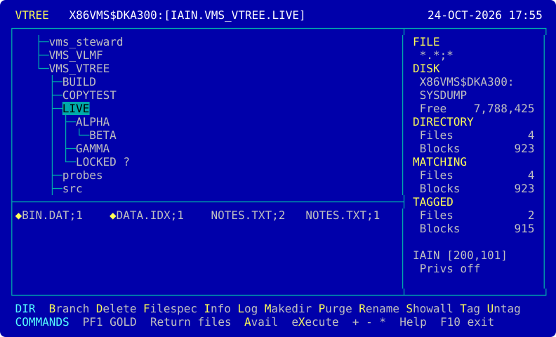

<p align="center">
  
</p>

# vms-vtree

[](https://github.com/issinoho/vms-vtree/releases/latest)
[](https://github.com/issinoho/vms-vtree/releases)

[](LICENSE)

A full-screen file and directory manager for OpenVMS x86-64 and IA64, inspired by
XTree Gold and dressed as a DEC application: a directory tree above a file window,
one-letter commands, tagging, VT line drawing, the LK201 editing keys (Find, Select,
Remove, Prev/Next Screen, Help, Do), and PF1 as the GOLD key for a second set of
commands. The screen uses XTree Gold's colours.

**Status: 0.1.1, an early test release.** Written for OpenVMS from scratch in C99; not
a port. See [docs/PLAN.md](docs/PLAN.md) for how it was built, phase by phase.

## What it does

| | |
|---|---|
| **Browse** | the tree, read as you open it (so a large disk starts at once), any mounted disk; file lists by directory, branch or whole disk; filespecs (`*.COM;*`), all or highest versions, sorting; tagging |
| **Look** | view any file by records (indexed files in key order) or in hex; Info as `DIRECTORY/FULL` gives it, with the ACL; search the tagged files' text; compare two with DIFFERENCES |
| **Change** | make, rename, delete and prune directories; graft a branch elsewhere on the disk; copy, move (across disks too), rename, delete, purge; edit; a DCL subprocess |
| **Secure** | protection, owner, ACL entries, expiration date, `/NOBACKUP`, erase on delete |

## Safety first

- VTREE turns off the privileges that override file protection (BYPASS, SYSPRV,
  READALL, GRPPRV) while it runs, so it can only do what protection allows.
  `VTREE/PRIVILEGES` keeps them on for a system manager; the title line then says
  PRIVILEGED, in red, for the whole session.
- Copy behaves as DCL COPY does and never overwrites (the copy is a new version). A
  copy or move that would make RMS delete old versions because of a version limit is
  refused.
- A delete shows what will go and asks; the answer defaults to No, and keys typed
  ahead never answer a question. A prune also wants the directory's name typed back,
  and is refused if anything in the branch is an alias (such as `SYSCOMMON` on a
  system disk) or can't be read. Only exact versions are deleted, chosen from a fresh
  reading of the disk.
- Every change goes to an operation log (`SYS$LOGIN:VTREE.LOG`, or `VTREE$LOG`).
- Files reach DCL commands (edit, compare, print) as logical names, never inside a
  command line.

The reasoning is in [docs/DECISIONS.md](docs/DECISIONS.md), and what the platform
was seen to do in [docs/NOTES.md](docs/NOTES.md).

## Installing

From the [latest release](https://github.com/issinoho/vms-vtree/releases/latest):

```
$ SET FILE/ATTRIBUTE=(RFM:FIX,LRL:8192,MRS:8192,RAT:NONE) ISSINOHO-*-VTREE-T0001-1-1.PCSI
$ PRODUCT INSTALL VTREE /PRODUCER=ISSINOHO /SOURCE=dev:[dir]
$ @VTREE$ROOT:[000000]VTREE$SETUP.COM
$ VTREE
```

Add `@SYS$STARTUP:VTREE$STARTUP.COM` to `SYS$MANAGER:SYSTARTUP_VMS.COM` so the
`VTREE` logical name is there after a reboot. It needs a VT100-compatible terminal of
at least 24 x 80; on one without colour, `DEFINE VTREE$DISPLAY MONO`. Help (or PF2,
or `?`) shows the keys; F10 or Ctrl/Z leaves.

## Building

On the node: `@BUILD_VMS` (add `TEST` to run the unit and screen tests too). On
Linux, `make test` builds the portable core and app against an in-memory disk and
checks 300 things, screens included. `tools/kit.sh <node>` makes a PCSI kit.

XTree is a trademark of its owners; vms-vtree is unrelated to it and contains none
of its code.

## Licence

MIT. See [LICENSE](LICENSE).
